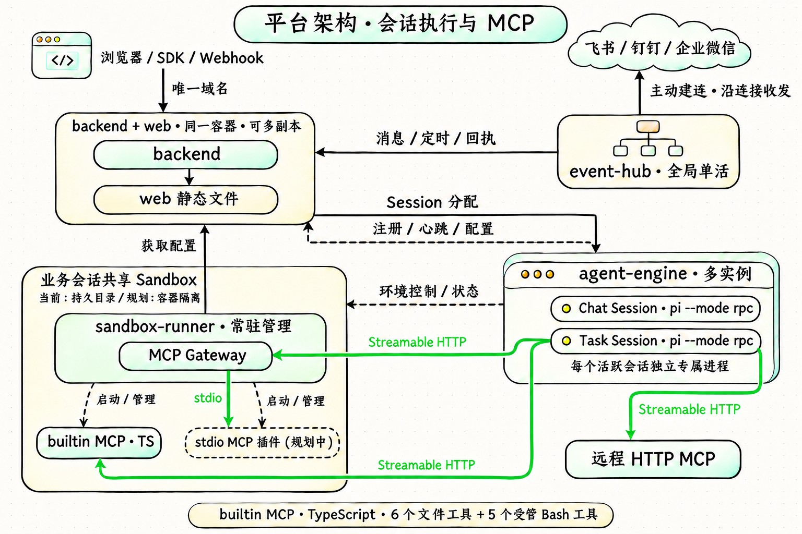

<div align="center">


# KIKO 企业级 AI 员工云平台

**把岗位职责、业务工具和工作方法配置成「AI 员工」，在 飞书、钉钉、企业微信里随时委派任务。**

[](LICENSE)
[](backend/go.mod)
[](web/package.json)
[](sandbox-runner/builtin-mcp/package.json)

[快速开始](#快速开始) · [核心特性](#核心特性) · [整体架构](#整体架构) · [功能矩阵](#功能支持矩阵) · [文档中心](docs/README.md) · [部署指南](docs/deployment.md) · [安全说明](SECURITY.md) · [参与贡献](CONTRIBUTING.md)

</div>

---

**KIKO 企业级 AI 员工云平台**（KikoTeam）面向人机团队协作，支持企业自托管。可以为不同岗位（如研发交付助理、经营数据分析师）创建专属 AI 员工，为其绑定模型、**Skill（工作方法包）** 与 **MCP 插件（业务工具）**——**让 AI 员工持续关注业务，在工作群里沟通，在企业自己的环境里办事，并在授权范围内跨群推动结果。**

不同于把记忆与账号绑在个人身上的**个人对话助手**，也不同于仅围绕研发工单驱动代码生成的**多 Agent 编排工具**，KIKO 面向企业多岗位日常协同，采用 **Super Agent「前台轻对话 + 后台隔离执行」** 双层架构，将持续沟通、后台长时任务、跨群多员工接力与分场景权限边界融为一体。

## 核心特性

- **边聊边做，沟通与执行解耦**：前台对话负责澄清需求与同步进展，耗时的分析、文件处理与工具调用转入后台独立运行；任务执行期间照常聊天，随时补充要求也不打断进度。
- **主动发现与推进，结果直达项目群**：不止被动等指令——可监听群消息、定时巡检、外部系统事件（Webhook）主动跟进变化、推进任务，并将结果直接投递回飞书、钉钉或企业微信群。
- **人工把关与多AI员工接力闭环**：同一 AI 员工可跨私聊与多个工作群协作；遇到关键决策向指定同事发起人工确认，也可将事项交接给下一位 AI 员工复核验收，全流程进度在看板一目了然。
- **企业自托管与可控授权**：一键部署在企业自有环境，数据与凭据不出内网；办公渠道走主动长连接，无需暴露公网入口，并可按私聊、群聊、自动触发分别限定可用工具。

## 整体架构



> **图示说明**：详见[整体架构速览](docs/architecture/README.md)。

### 核心概念

| 概念 | 含义 |
| --- | --- |
| **AI 员工（`Agent`）** | 工作区内持续承接工作的岗位身份，绑定模型配置（`ModelProfile`）与一个或多个能力包（`CapabilityPackage`）。 |
| **能力包（`CapabilityPackage`）** | 固定版本的 Skill、MCP 插件工具清单与账号绑定组合，可分别配置私聊、群聊、触发器三个场景的使用范围。 |
| **业务会话（`Conversation`）** | 用户或群聊与某位 AI 员工的持续交互上下文，拥有唯一主对话（`chat` Session）和共享的工作目录（`Sandbox`）。 |
| **后台任务（`Task`）** | 由对话委派或触发器创建的后台工作项，一对一绑定独立的执行会话（`task` Session），不阻塞前台继续聊天。 |
| **输入与轮次（`Input` / `Turn`）** | 每次发送的消息或补充要求记为一条幂等 `Input`；Engine 领取后启动一个 `Turn`，期间可多次调用模型与 MCP 工具。 |

### 功能支持矩阵

| 功能模块 | 支持能力 | 状态 | 说明 |
| --- | --- | --- | --- |
| **AI 员工与模板市场** | 官方模板创建、自定义岗位、团队模板发布与复用 | ✅ 已支持 | 将零散的个人提示词沉淀为标准岗位配置，降低落地门槛，让验证成熟的经验在团队间快速复制 |
| **对话与办公群聊** | Web 私聊与群聊、飞书/钉钉/企业微信接入、附件收发 | ✅ 已支持 | 团队原有沟通工具，让人机协同无缝融入日常办公场景，避免在多个工具间来回切换 |
| **后台任务执行** | 边聊边做、待办计划、运行中补充要求、停止与归档 | ✅ 已支持 | 解决复杂长任务阻塞对话、中途难纠偏的痛点，让前台沟通与后台耗时执行解耦，随时补充需求也不打断进度 |
| **多员工与人机协同** | 指定成员人工确认、跨员工事项交接、三列事项看板 | ✅ 已支持 | 避免 AI 在关键决策上“自作主张”，同时打通多岗位接力复核与状态追踪，形成可控可验收的团队交付闭环 |
| **主动感知与自动触发** | 定时任务、固定时间提醒、外部系统事件（Webhook）触发 | ✅ 已支持 | 打破 AI“不问不动”的被动模式，让例行巡检、汇总汇报与异常跟进 7×24h 自动运转，减少人工盯盘与遗漏 |
| **技能与业务工具** | 工作方法包（Skill）导入、外部业务系统（MCP）接入与账号绑定 | ✅ 已支持 | 解决通用大模型不懂企业 SOP、连不上内部系统的局限，让 AI 按团队规范操作真实业务工具完成交付 |
| **权限与安全边界** | 成员/部门使用范围、跨群信息共享、分场景工具控制 | ✅ 已支持 | 防范敏感数据越权访问、跨群串话与高风险误操作，确保 AI 在私聊、群聊与自动触发下都守住权限边界 |
| **模型与私有化部署** | 主流大模型接入、官方模型与积分、企业自有环境一键自托管 | ✅ 已支持 | 避免被单一模型厂商锁定，同时满足数据不出内网的合规要求，让模型、凭证与业务数据全部自主可控 |
| **工作目录与脚本执行** | 持久项目目录、文件读写检索、命令行与脚本执行 | ✅ 已支持 | 让 AI 不再止步于文本回复，而是能直接处理文件、运行脚本并沉淀可复用成果（注：当前默认同账号运行，**不提供容器级安全隔离**） |
| **后续规划** | 容器化强隔离沙箱、本地插件进程托管、图片与语音理解 | 🚧 规划中 | 面向高安全等级环境补齐执行隔离与本地工具接入能力，并打通群聊中图片、语音等非文本信息的处理链路 |

### 组件地图

| 组件 | 部署与实现 | 职责 |
| --- | --- | --- |
| [web](web/README.md) | Vue 3 + TypeScript 静态构建，随 `backend` 同容器发布 | AI 员工工作台、任务与事项协同中心、资源库与工作区管理控制台 |
| [backend](backend/README.md) | Go，单一公网域名下可多副本 | 前端静态路由、账号与权限、资源与能力包、Engine 注册心跳、Session 分配与内部协作 MCP |
| [event-hub](event-hub/README.md) | Go，基于 PostgreSQL Advisory Lock 全局单活（可部署热备） | 启动时自动执行 PostgreSQL 迁移；维护飞书/钉钉/企微长连接、业务定时触发与结果投递 |
| [agent-engine](agent-engine/README.md) | Go，可多实例 | 为每个活跃 Session 托管专属 `pi --mode rpc` 进程，装配 Skill/MCP 配置，管理 Sandbox 与原生历史 |
| [sandbox-runner](sandbox-runner/README.md) | Go 管理进程 + TypeScript [builtin-mcp](sandbox-runner/builtin-mcp/README.md) | 在 Sandbox 内管理工作目录与工具进程，向 Pi 暴露内置文件与受管 Bash 工具 |

## 快速开始

### 1. 环境准备

在 **macOS** 或 **Linux** 上准备：

- **Docker Engine + Docker Compose v2**（若尚未安装，`./start.sh` 会提供交互式官方源安装引导）
- Git（通过下方命令克隆时需要），以及空闲的本机 `18080` 端口

> 不需要在宿主机安装 Python、Go、Node.js 或 PostgreSQL。办公渠道使用主动长连接，接入时无需开放入站端口；外部 Webhook 则需要调用方能访问的 Backend 地址。

### 2. 一键启动

```sh
git clone https://github.com/unrealm-ai/kikoteam.git
cd kikoteam
./start.sh
```

首次运行会自动初始化 `.env` 与 `.kiko-local/runtime.env`（生成随机数据库密码、认证密钥与内部服务 Token），启动 PostgreSQL、Backend（含 Web 前端）、Event Hub 与 Agent Engine。启动过程中自动完成迁移、同步内置目录并等待 Engine 注册。首次下载依赖和构建镜像可能需要数分钟。

启动完成后，浏览器打开：

```text
http://localhost:18080
```

本地入口只监听回环地址；同一个 Docker 引擎默认只管理一套本地实例。已有实例应回到原目录启停，不要另克隆一份覆盖数据卷。

### 3. 三步跑通第一个任务

1. **注册账号**：本地默认关闭邮箱验证码，直接用邮箱和密码注册。**第一个注册并登录的用户会自动成为平台管理员**。
2. **添加模型**：进入「**资源库 → 模型**」，添加一条模型配置（支持 OpenAI Chat Completions、OpenAI Responses、Anthropic Messages 协议，如 DeepSeek、OpenAI、Claude 等），点击测试连接并保存。
3. **创建 AI 员工并委派任务**：进入「**AI 员工市场**」，选择一个内置模板（例如「经营数据分析师」或「行情简报员」），选定刚配置的模型即可完成创建。点击进入对话，直接发送需求或上传文件让它启动后台任务。

### 常用管理命令

| 命令 | 说明 |
| --- | --- |
| `./start.sh` 或 `./start.sh up` | 使用当前本地代码构建并启动，不拉取 Git 更新 |
| `./start.sh --update` | 快进拉取当前分支的上游，再构建并启动 |
| `./start.sh restart` | 兼容已有用法，有 Git 工作区时先拉取更新再构建并启动 |
| `./start.sh status` | 查看各容器运行与健康检查状态 |
| `./start.sh logs` | 查看服务日志 |
| `./start.sh down` | 停止容器（保留 PostgreSQL 数据卷与 `~/.kiko` 工作目录） |

### 容器镜像

`main` 分支代码变更由 [GitHub Actions](.github/workflows/images.yml) 自动构建并发布以下三个 `linux/amd64` 镜像（同一批发布共用 7 位 Git 短 SHA，校验通过后同步更新 `latest` 标签）：

| GHCR 镜像 | 内容 |
| --- | --- |
| `ghcr.io/unrealm-ai/kikoteam/backend` | Backend 服务与 Web 前端静态资源 |
| `ghcr.io/unrealm-ai/kikoteam/event-hub` | Event Hub 服务与内嵌的 PostgreSQL 迁移文件 |
| `ghcr.io/unrealm-ai/kikoteam/agent-engine` | Agent Engine、Pi 运行时、Sandbox Runner 与 builtin-mcp |

拉取示例：

```sh
docker pull ghcr.io/unrealm-ai/kikoteam/backend:latest
```

<details>
<summary>镜像触发规则与手动验收工作流说明</summary>

- 每个 PR 和每次推送到 `main` 都会运行静态检查，涉及相应路径时还会运行组件检查和本地 Compose 集成测试。各检查也可在 **Actions** 中手动运行。
- 每次推送到 `main` 都会构建三个镜像，包括纯文档变更。工作流按本次提交的 SHA 验证部署准入，并用打包后的 Engine 运行端到端测试。验收通过后才更新 `latest` 和部署指针。
- 在 **Actions → Published image acceptance → Run workflow** 可以单独复验已发布的镜像，默认使用 `latest`，也可指定完整提交 SHA。

</details>

完整教程与故障排查见 **[5 分钟快速上手](docs/getting-started.md)**；面向团队或生产环境上线前，请先阅读下方 **[安全提示](#安全提示)**。

## 开箱即用的内置资源

系统启动后会自动同步官方目录（源码与许可证清单见 [backend/internal/platform/service/catalog/](backend/internal/platform/service/catalog/)）：

| 类别 | 内置清单 |
| --- | --- |
| **AI 员工模板（7 个）** | 经营数据分析师 · 会议跟进专员 · 客户跟进助理 · 内容运营编辑 · 用户反馈分析师 · 研发交付助理 · 行情简报员 |
| **官方 Skill（11 个）** | 项目周报与风险汇总 · Excel 合并与公式校验 · 账表对账 · 用户反馈归纳 · 客服 FAQ 整理 · 竞品与行业简报 · 多渠道内容初稿 · 汇报 PPT 制作 · GitHub PR 评审 · Tavily 资讯检索与核实 · A 股收盘简报 |
| **官方 MCP 插件（11 个）** | 免认证：A 股行情快查、Exa 公开资料检索<br>API Key / Bearer：GitHub、Tavily 联网搜索、智谱联网搜索、同花顺 A 股行情、飞书云文档、腾讯会议纪要、钉钉待办、高德地图<br>OAuth：纷享销客 CRM（GitHub 同时支持 OAuth 与 PAT） |
| **沙箱内置工具（11 个）** | 文件工具：`read`、`write`、`edit`、`grep`、`find`、`ls`<br>受管进程工具：`bash_start`、`bash_poll`、`bash_write`、`bash_terminate`、`bash_list` |

## 文档导航

- **新手与使用指南**
  - [文档中心首页](docs/README.md)
  - [5 分钟快速上手](docs/getting-started.md)
  - [AI 员工、能力包、Skill 与 MCP 插件指南](docs/guides/employees-and-capabilities.md)
  - [渠道接入、自动化触发与人机协同指南](docs/guides/channels-and-collaboration.md)
- **部署、运维与安全**
  - [部署与环境变量配置指南](docs/deployment.md)
  - [安全模型与部署安全清单](SECURITY.md)
  - [最小会话底座本机原生运行说明](docs/operations/minimal-agent-runtime.md)
- **架构与二次开发**
  - [参与贡献与本地开发指南](CONTRIBUTING.md)
  - [设计与开发文档总索引](docs/design-index.md)
  - [整体架构速览](docs/architecture/README.md) · [领域模型](docs/architecture/domain-model.md) · [会话生命周期](docs/architecture/conversation-lifecycle.md)
  - [编码代理入口（AGENTS.md）](AGENTS.md) · [工程开发规则（AI_RULES.md）](AI_RULES.md)

## 安全提示

> [!IMPORTANT]
> 当前版本的 Sandbox（`sandbox-runner` 与 `builtin-mcp`）采用**宿主机/容器内持久目录 + 同运行账号子进程**模式，**不提供操作系统级或容器级安全隔离**。AI 员工执行的 Bash 命令与脚本拥有 `agent-engine` 运行账号相同的文件与网络访问权限。请仅向受信任的工作区成员开放代码执行类能力，生产部署前请务必阅读 **[SECURITY.md](SECURITY.md)**。

## 参与贡献

欢迎提交 Issue 和 Pull Request！在开始修改代码前，请先阅读 **[CONTRIBUTING.md](CONTRIBUTING.md)** 了解开发环境配置、`make lint` / `make check` 静态检查与测试要求，并遵守 **[行为准则（CODE_OF_CONDUCT.md）](CODE_OF_CONDUCT.md)**。如果你使用 AI 编码助手协作开发，可直接将其入口指向仓库根目录的 [AGENTS.md](AGENTS.md)。

## 开源许可

本项目基于 **[KIKO Open Source License（Apache License 2.0 附加商业限制条款）](LICENSE)** 开放源码：

- **免费与内部自托管**：允许个人学习研究、企业/组织**内部自托管部署**使用，或为特定单一客户内部自用提供私有化部署与定制集成。
- **商业限制条款**：未经许可方另行书面商业授权，**禁止**将本项目或其衍生作品作为多租户 SaaS、托管云服务对外商业化运营或售卖，且**禁止**移除或篡改前端工作台与管理界面中的 `KIKO`（`KikoTeam`）品牌标识、Logo 与版权归属声明。

第三方依赖与渠道商标归属说明见 **[NOTICE](NOTICE)** 及各组件目录下的 `THIRD_PARTY_NOTICES.md`。
