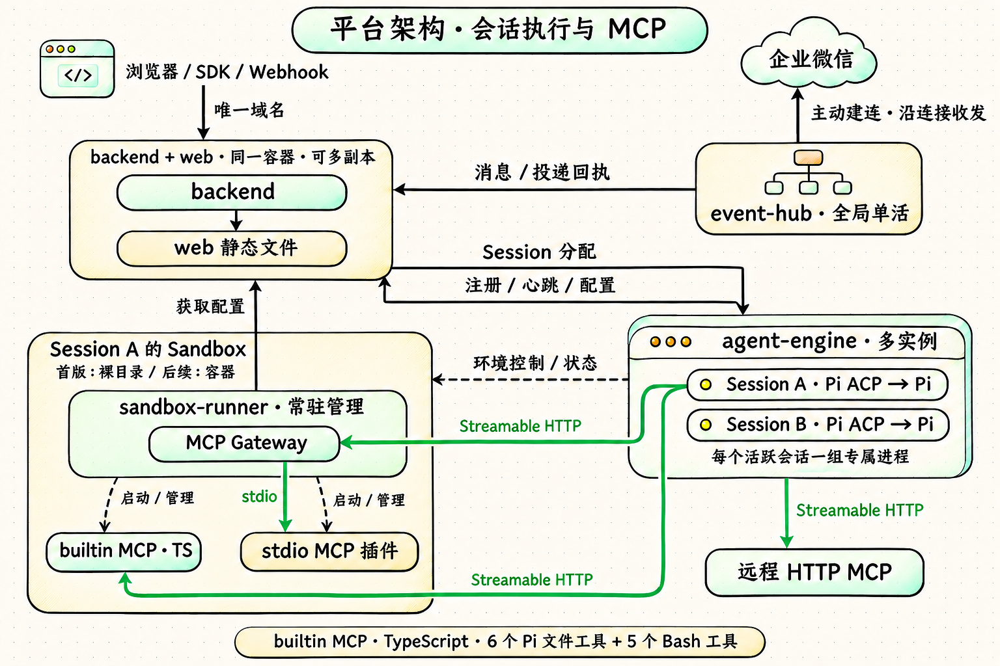
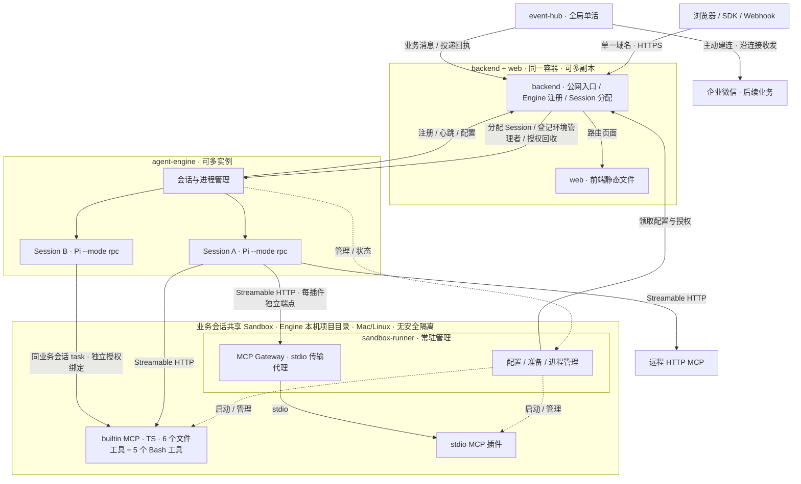

# 整体架构速览

**模块与生命周期设计（2026-11-16）**：Backend 按 `platform`、`manager`、`webgw` 划分，内部 task_delegation 归 `manager/mcp`，对外 Webhook/MCP 在 `webgw` 下预留。Manager 负责业务对象、Session 分配和环境回收裁决；Hub 聚焦长连接与业务定时。见[系统模块边界](system-modules.md)和[生命周期](conversation-lifecycle.md)，目标设计不代表执行代码已实现。

AI 员工在群里接到一项委派后，可以一边和用户交流，一边在后台工作。平台结合了员工身份、企业渠道、任务与人工协作的业务模型，以及版本化 Agent、托管 Pi 和会话沙箱的执行模型。本页描述项目的整体架构。

**范围说明：当前按[会话底座需求](../product/agent-sessions.md)规划核心资源、业务会话/任务关联、文本和工具执行。创建、停止、归档及回收已确认，见[业务会话与共享环境生命周期](conversation-lifecycle.md)。** 企微、业务结果投递和文件体系仍属后续方向；[builtin MCP](../../sandbox-runner/builtin-mcp/README.md) 已有独立实现，执行编排尚未贯通。

## 一张手稿看全局

该手稿保留早期 Pi ACP 进程标注；当前执行链为 `Engine → pi --mode rpc → 模型/MCP`，pi-acp 已移除。

Backend 向 Engine 分配 Session，Engine 反向注册、心跳和领取配置。Sandbox 内的 Runner 独立向 Backend 获取配置，管理环境及插件进程。绿色箭头表示 Pi 的三条 MCP 调用路径：直连 builtin MCP、经 Runner Gateway 访问 stdio 插件、直连远程 HTTP MCP。Gateway 位于 Runner 内部，不新增部署组件。

手稿 v4 表达组件通路，其中“Session A 的 Sandbox”表示 A 使用该环境；按[最新业务会话归属](storage-paths.md)，同一业务会话的任务可共享 Sandbox，执行 Session 的原生历史、权限和后台进程分别管理。下面的关系图采用这一归属；chat 不申请 Sandbox。固定 Token 与原生历史继续的执行细节见后文及组件设计。

**公网只有一个域名，所有外部入站请求都由 Backend 接收。** Web 静态文件与 Backend 打包进同一个容器，每个 Backend 副本都提供页面、业务接口、SSE 和外部回调。Engine 和 Sandbox 的管理 / MCP 地址仅供内部受限访问，不新增公网入口。

全局单活的 event-hub 主动向企业微信建连，沿已建连接接收和回复；无需公网入站地址。它将业务输入交 Backend，Session 分配不经过 event-hub。

## 五个组件如何协作

每个活跃 Session 由 Engine 管理专属 Pi RPC，跨轮复用，释放后用原生上下文继续。同一 Conversation 的 task Session 首版固定到同一 Engine/宿主，chat 可独立分配。Sandbox 就是 Engine 本机的稳定项目目录，Runner 是同账号子进程；上图分框表示职责，不是操作系统环境隔离。首版目标为 Mac/Linux 本地运行，不要求 Docker 或独立 Sandbox 服务；容器只保留扩展。见[裸 Sandbox 设计](../../sandbox-runner/docs/local-sandbox.md)。

## 业务会话与生命周期

一个 Conversation 按需创建唯一主 chat Session，包含多个 Task；首版每个 Task 对应唯一 task Session，并共用业务会话的 Sandbox。Backend 创建和分配对象，Engine 管 Pi 与物理环境，Runner 按 Session 管环境内进程。

停止主对话不停止任务；停止或归档任务 A 不影响任务 B，也不回收共享 Sandbox。Conversation 归档先关闭全部准入，再归档和收尾所有 Session；Backend 核验停稳后授权管理 Engine 回收运行资源，Runner 先关闭内部服务和进程。活跃业务会话不自动空闲回收环境，Pi 原生历史及工作文件保留。关系图、并发创建和三层回收详见[生命周期正文](conversation-lifecycle.md)。

## 组件职责

| 组件 | 主要职责 |
| --- | --- |
| [web](../../web/README.md) | 工作台与管理控制台，随 Backend 发布；配置管理已有实现，对话执行待接入；区分停止任务与归档整个业务会话，不直控 Engine/Runner。 |
| [backend](../../backend/README.md) | 唯一公网入口；配置及授权、Conversation/Task/Session 创建与归属、Input/控制受理及事件查询；分配 Session、登记唯一环境及管理 Engine、裁决归档回收，提供运行配置。 |
| [event-hub](../../event-hub/README.md) | PG 选举全局单活并自动迁移数据库；后续持有机器人长连接、触发业务计划、投递结果和上报回执。Session 分配由 Backend 承担。 |
| [agent-engine](../../agent-engine/README.md) | 按 Backend 分配管理 Session 和专属 Pi RPC；装配配置、执行 Input/Turn、提交事实及保留原生历史；按 Backend 授权创建/释放环境并协调 Runner。 |
| [sandbox-runner](../../sandbox-runner/README.md) | Sandbox 内常驻管理，向 Backend 获取配置，准备资源、启动 TS builtin MCP（11 个工具）和本地插件；为 stdio MCP 提供独立 HTTP 代理端点，处理管理状态和收尾。 |

## Agent 会话底座

当前规划 Agent、员工能力包、ModelProfile、Skill、Plugin、PluginAuth、Session、Input 和 Turn，实际交付状态见迁移矩阵。员工通过包绑定 Skill 与 Plugin，同员工多个包同插件共用员工账号授权，各包工具范围可不同。Agent 只有一套面向任务的配置，保存即生成版本；模型生成参数跟随 Harness。chat 使用平台预设，task 使用 Agent 配置与默认 Sandbox，创建时不接受交流范围、父会话、指定 Skill 或 Sandbox 覆盖参数。

同一 Session 顺序执行 Input，一条输入最多一个逻辑 Turn。故障中断旧 Turn，后续“继续”等新 Input 加载同一 Pi 原生会话，不自动重跑旧轮次。后台进程归执行 Session，可跨正常 Turn 存活；stop/归档仍收尾它们，不能凭 idle 自动回收环境。Sandbox 工具 Token 随环境生命周期固定，管理凭据独立。未开始输入可撤回；每次 stop 覆盖该次受理时已有工作，无 key；归档后只读且不提供恢复或删除。Skill 意图交给 Harness，CLI / MCP 授权由 PluginAuth 管理，默认直接执行已获准工具。

Backend 各副本都可即时分配，数据库锁和约束防止双分配与超卖；周期维护独立选主，补偿通知和核对失联 Engine。event-hub 第一阶段仍部署并负责数据库自动迁移，Backend 和 Engine 不检查结构版本、不以迁移完成作为进程启动前提，见[event-hub 启动设计](../../event-hub/README.md#启动与数据库迁移)。

## 企微群里的一份周报

> 项目群成员向机器人发送定向消息：“请用我刚上传的表格整理本周交付情况，做成报告发回这个群。”

1. **接单。** event-hub 收到企微定向消息后将来源和消息 ID 提交 Backend；业务层核验并确定 Conversation，原子创建 Task、唯一 task Session 和输入。渠道映射及文件流程后续设计。
2. **开工。** Backend 首次选定共享 Sandbox 的管理 Engine/宿主，后续任务复用该放置。Engine 准备环境，Runner 获取配置并启动 MCP；Pi 在 Engine 中使用独立上下文直连工具，具体报告工具由后续方案补齐。
3. **交回成果。** Pi 保存原生历史，Engine 提交执行完成事实。报告发布、下载及业务任务完成判定由后续文件和业务方案定义，之后 Backend 创建面向原群的投递记录。
4. **送达。** event-hub 使用对应机器人连接发送结果并回报回执。任务完成与结果送达分别展示；发送未知时核对原投递，不因渠道失败重新执行报告任务。

## 去哪里查事实

| 想知道什么 | 权威位置 |
| --- | --- |
| 输入是否受理、停止范围、会话是否归档 | Backend 维护的 Session、Input、停止边界及输入去重引用 |
| 哪台 Engine 可以执行、容量占多少 | Backend 保存的 Engine 注册、Session 分配与代次，记录在 PostgreSQL |
| 本轮结果和原生上下文 | Turn/可靠事件以数据库为准；模型上下文由 Pi 原生历史及 Engine 身份映射保存 |
| Sandbox 是否就绪、MCP 在哪里 | Runner 当前实例、boot、配置修订和端点状态；插件第三方认证来自 PluginAuth，builtin 使用专用运行时访问凭据 |
| 工具执行到哪一步 | Pi 原生事件及可核对的目标 MCP 证据；builtin 命令、输出及活动事实见其私有账本；第三方 MCP 按自身能力核对 |

## 按问题深入

- 业务会话、任务、Session 和共享 Sandbox 是什么关系，谁负责创建/停止/回收？见[生命周期设计](conversation-lifecycle.md)。
- Mac/Linux 本地如何运行，目录、进程和容器扩展怎样安排？见[裸 Sandbox](../../sandbox-runner/docs/local-sandbox.md)。

- 注册、心跳、容量和多 Backend 分配怎样实现？见[Backend 注册与分配](../../backend/docs/engine-dispatch.md)。
- Pi RPC 如何启动、复用、停止和恢复？见[Engine 运行时设计](../../agent-engine/docs/session-runtime.md)。
- Runner 如何领取配置、管理环境及代理 stdio MCP？见[Runner 运行时设计](../../sandbox-runner/docs/runtime-and-mcp.md)。
- 内置 11 个工具如何复用、接入与收尾？见[builtin MCP 设计](../../sandbox-runner/docs/builtin-mcp.md)。
- 配置快照、Input / Turn 状态与并发裁决？见[数据模型](session-data-model.md)。
- 14 个接口、事件历史和实时流？见[Backend 入口设计](../../backend/docs/http-api.md)及[会话详细设计](../../backend/docs/session-api.md)。
- 平铺事件字段、五类核心 type 和增量如何消费？见[会话事件协议 v1](../../backend/docs/session-events.md)；type 是预设计目录，按功能需要采用定义，不要求一次全部实现。
- 主 chat 如何通过远程 MCP 创建、查询、继续和停止任务会话？见[task_delegation](../../backend/docs/task-delegation-mcp.md)；六个查询式工具已实现，外部业务 MCP 仍未实现，结果回报不等于 MCP 创建响应或自动唤醒。
- 资源及数据归属、恢复边界？见[领域模型](domain-model.md)、[数据归属](data-ownership.md)、[运行时与隔离](runtime-and-isolation.md)。
- 后续渠道与协作流程？见[对话与任务](../flows/conversation-and-task.md)、[触发与分配](../flows/triggers-and-dispatch.md)、[人工继续与事项交接](../flows/human-and-handoff.md)。
