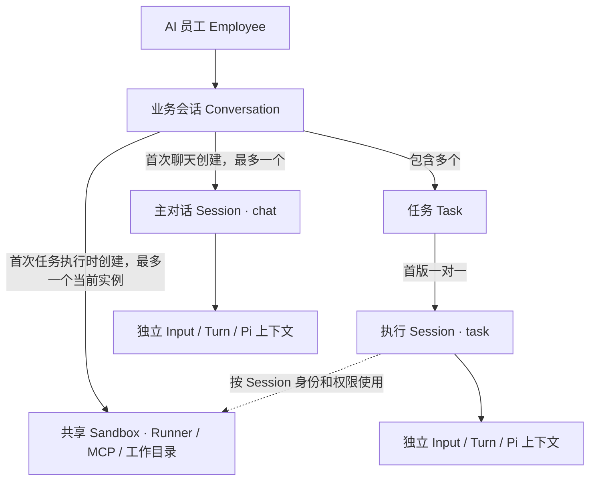

# 业务会话、任务与共享环境生命周期

状态：2026-11-16 最小 API 与裸环境生命周期已实现，本地确定性模型服务的实际进程验收通过。本文维护完整职责与目标；已交付范围、机器契约与限制见[运行说明](../operations/minimal-agent-runtime.md)。具体执行状态见[数据模型](session-data-model.md)，分配见[Backend 设计](../../backend/docs/engine-dispatch.md)。

> 2026-11-18 增量：本文的共享环境与 Conversation 必属关系描述普通会话任务。新增 TaskSpace 任务采用互斥业务归属、每任务独立环境，当前实施边界与验收见 [TaskSpace 设计](../../backend/docs/task-spaces.md)，不将本页旧关系扩展到新空间任务。

## 对象关系

| 对象 | 归属与作用 | 首版约束 |
| --- | --- | --- |
| Conversation | 某工作区、AI 员工下持续的业务交流范围 | 创建只登记元数据；最多一个主 chat Session、多个 Task、最多一个当前 Sandbox |
| Task | 一件业务工作，保存目标、来源和业务结果关联 | 必须属于 Conversation；与自己的 task Session 同事务创建且一对一，使用不同 ID |
| Session | 独立配置快照、模型上下文、输入和轮次 | 必须属于 Conversation；chat 没有 task_id，task 必须关联唯一 Task；mode 和归属不可修改 |
| Sandbox | Conversation 的工作环境 | task Session 只持有使用关系；chat 不申请、不使用该环境，也不获得任务工具 |

首版采用[Mac/Linux 裸 Sandbox](../../sandbox-runner/docs/local-sandbox.md)：Engine 本机的稳定项目目录及受管进程，Runner 是 Engine 启动的同账号子进程，不提供安全隔离。容器仅保留后续扩展，不要求独立 Sandbox 系统。

同一 Session 串行处理 Input，不同任务可以并发。共享环境不合并 Pi 原生历史、能力包权限或插件账号。Task 的业务完成由 Backend 业务层确认，Turn 结束只代表一条输入处理结束，不能直接推断任务完成、没有后台命令或环境可回收。任务的详细结果协议仍在后续业务设计中定义。

追加要求、停止后继续、进程故障后发送“继续”，均沿用原 Task 和 Session，增加 Input/Turn。进程重建不新建业务对象，不引入 Run 或同一 Turn 的恢复尝试；需要另一件工作时才创建新 Task。归档后不恢复原对象或复制其上下文。

本关系定义同一员工内的业务会话。跨员工委派、来源业务 key、渠道映射及文件/记忆 API 仍单独设计，不能因为结果需要回到原会话就默认跨员工共享工作环境。

## 创建与准入

| 时点 | Backend / Manager | Engine / Runner |
| --- | --- | --- |
| 创建 Conversation | 核验工作区和员工，保存业务范围及 active 生命周期 | 不分配模型进程，不创建 Sandbox |
| 首次聊天 | 在 Conversation 内唯一创建 chat Session；携带输入时同事务受理 Input；后续聊天向该 Session 提交 Input | 有待执行输入才分配 Engine、启动 Pi；不依赖 Runner |
| 创建 Task | 一次建立 Task、task Session、配置快照；立即开始时将首条 Input 一并提交 | 空任务 Session 不启动 Pi 或 Sandbox；开始执行时取得共享环境 |
| 后续任务 | 新建独立 Task/Session，保留同一 Conversation 关联 | 复用该业务会话的 Sandbox，各自使用独立 Pi 上下文与授权绑定 |

业务入口调用同一 Backend 用例，不要求客户端先创建 Task 再创建 Session。Session 底座仍使用统一的 14 个操作；调用方必须提供或由可信业务入口解析出 Conversation，Backend 校验归属并创建 Task 关联，不允许创建脱离业务会话的执行记录。具体 HTTP 候选字段见[Session API](../../backend/docs/session-api.md)，Conversation 管理和任务业务结果端点后续单独细化。

主 chat 通过[task_delegation MCP](../../backend/docs/task-delegation-mcp.md)进入上述同一用例：从专用运行身份解析 Conversation / 来源 chat，原子建立 Task、唯一 task Session、首条 Input 和来源关联；不接受模型自报父级、不另建委派状态机。六个工具仅为已确认的预设计，仍待实现。轮次回报不等于业务 Task 完成，自动投递到主会话上下文及唤醒的具体接入由整体对话契约继续细化。

首次主对话的并发创建通过 Conversation 锁和唯一约束裁决。只有 Input 提交使用去重键；含首条输入的创建重放返回原对象，不能重复创建 Task。普通空 task 创建没有请求级去重承诺，可能产生多个不同 Task/Session；空 chat 创建受“最多一个主对话”约束，不创建第二个。

Conversation、Task/Session 的准入一并核验。父 Conversation 归档后，即使子 Session 的异步归档尚未完成，也必须拒绝新输入、新任务和排队输入的领取；已经开始的执行允许提交收尾事实。首次主 chat Session 已归档时，不在原 Conversation 内暗中替换它；需要新的主对话则新建 Conversation，原有任务的生命周期仍独立。

## 环境登记与首版放置

Backend 在数据库中裁决 Conversation 的唯一当前 Sandbox，保存宿主和管理 Engine。管理 Engine 是现有 Engine 实例承担的一项职责，不新增部署组件，不取代 Backend 调度；其环境管理责任不随首个任务的结束或 Session 分配释放而解除。

1. 首个 task 待执行时，Backend 在短事务中锁定 Conversation，核验准入，选定有容量且能力匹配的 Engine，登记环境身份、宿主和管理者，再分配 Session。
2. 获准管理 Engine 在事务外创建或找到固定项目目录，在本机启动 Runner 子进程。Runner 领取 Backend 配置，准备 MCP 并报告身份、准备状态及本机端点；不调用容器或环境供应服务。
3. 同时开始的其他任务读取同一环境登记，复用正在准备或已就绪的环境。重复通知沿用原环境身份；结果未知时核对原实例，不生成第二个环境。
4. 每个任务登记独立 Session 使用关系和授权窗口，再开始执行。不能将多个任务权限取并集后共同开放。

**同一 Conversation 的任务共用当前沙箱管理者。** 所有引擎按部署约定挂载同一份持久化存储。健康管理者容量已满时任务排队，chat 独立分配。

Engine 每次启动都获得新身份。周期调度确认旧执行已结束或其工具窗口已被隔离后，任意有容量的引擎可接管原沙箱，读取原项目和 Pi 历史。尚未领取的输入沿原队列首次执行。故障中断的 Turn 保留已有结果及待核对的副作用。

## 停止与归档

**归档准入（2026-11-17）**：运行中的业务会话不支持归档。首次归档 Conversation 时，在父记录排他锁内锁定全部关联 Session 并核验主 chat 与所有任务：有活动 Turn、排队 Input、后台进程、停止待确认或未知本地活动，均返回 HTTP 409 `conversation_busy`，不修改父子生命周期、停止边界或取消输入。请先停止相应 Session 并等待收尾。未知远程工具结果（`remote_tool_outcome_unknown`）本身不视为本地运行；本地已停稳时允许归档，但保留未知证据、运行门禁及环境回收限制，不宣称外部执行结束。当前没有用户侧核对清除入口，后续需另行实现，不能由归档清空该状态。单 Session 首次归档同样返回 409 `session_busy`。归档不代替停止。父锁与 Engine Claim 的 SHARE 锁互斥：领取先提交则归档拒绝；归档先提交则领取拒绝。已归档父级允许重试补齐子级收尾，兼容升级前已经受理的归档。保留 40P01 有限事务重试；此限制不证明原死锁锁环已定位或消除。

| 操作 | 作用范围 | 不随之发生的动作 |
| --- | --- | --- |
| 停止主 chat Session | 本次受理时该 Session 已有的工作 | 不停止已委派 Task，不释放共享 Sandbox |
| 停止 Task | 调用其唯一 Session 的 stop，覆盖当前已受理输入、轮次和所属后台命令 | 不归档 Task/Session，不影响其他任务，不删除环境或文件 |
| 再次停止 | 重新确定此时已有工作的范围 | 不使用 stop 幂等 key，不重放旧响应 |
| 归档 Task / task Session | 仅停稳后关闭该任务后续输入并归档对应 Session；Task 归档事实与 Session 保持一致 | 不归档 Conversation 或其他任务，不回收共享 Sandbox |
| 归档主 chat Session | 仅停稳后关闭其后续聊天并归档主对话 | 不级联归档 Task，不等同归档 Conversation |
| 归档 Conversation | 全部关联 Session 停稳后关闭整个业务范围的新任务和新输入并级联归档 | 不立即宣称执行已停止，不物理删除历史或工作文件 |

首版不增加“停止整个 Conversation”的独立操作。停止链路是 Backend 保存范围 → Engine 取消对应 Pi 执行 → Runner/builtin 按 Session 关闭准入并收尾本地工作 → Engine 提交实际执行状态。没有活动 Turn 也必须处理该 Session 的后台命令。未知结果保留待核对状态，远程 MCP 已接受的副作用不能由 Runner 宣告已撤销。

Conversation 首次归档先在父记录排他锁内核验全部子级停稳，再原子关闭准入并登记持久收尾意图，再逐个按已有 Session 归档语义处理。新建任务、创建 Session、提交 Input 和 Engine 领取都必须与该父边界互斥；不能等所有子记录更新完才关闭入口。已开始的执行结果、停止核对及可靠事件仍可提交。重复归档沿用原事实补齐未完成的子级收尾，不创建公开控制资源，不重复改变已归档对象的时间或版本。

## 三层回收

| 对象 | 条件与执行 | 保留内容 |
| --- | --- | --- |
| 单个 Session 的 Pi 进程 | 无活动 Turn、待执行 Input、在途调用、未决活动和所属后台命令时，Engine 可释放进程；Backend 确认释放分配容量 | Session、快照、Pi 原生历史和 Engine 身份映射；共享环境及管理者关系 |
| Sandbox 运行资源 | 首版在 Conversation 归档且全部参与 Session 收尾后，由 Backend 授权回收；管理 Engine 协调 Runner 关闭 MCP/插件和环境内进程，再释放运行资源 | 工作文件、进程核对证据、历史及原生上下文；不递归删除环境目录 |
| 持久数据 | 后续明确保留期及删除流程后另行处理 | 本轮不实现自动删除或破坏性 TTL |

**活跃 Conversation 的共享 Sandbox 不做自动空闲回收。** Turn 结束、Task 业务完成、所有 Session 暂时 idle 或某个 Session 归档，都不足以释放整个环境。有后台命令时首版保留所属 Session 的运行实例、容量及环境引用，禁止仅按“模型已回答”回收。

环境回收必须核对全部参与 Session：无新准入、无在途工具调用、无后台命令、无未知活动，所有执行窗口已经关闭。Runner/MCP 常驻服务自身不计入业务后台命令数，但应在回收末尾有序退出。清理失败保留待处理状态和原身份，不能清空账本后报成功；工具凭据随环境销毁失效，管理凭据独立。

裸目录回收主要释放 Runner、MCP、受管进程及监听端点，工作目录先保留。后续容器后端同样需要先定义保留工作盘的方式，不能让删除容器隐式删除工作文件。没有创建过 Sandbox 的 Conversation 归档不启动环境来清理。

## 组件职责与验收

| 组件 | 权威责任 |
| --- | --- |
| Backend / Manager | 对象创建、归属、业务生命周期、准入、停止意图、Session 分配、唯一环境及管理者登记、回收裁决 |
| Agent Engine | Pi 生命周期、Input/Turn 执行与实际结果；按授权创建/释放环境，协调 Runner 并报告收尾事实 |
| Sandbox Runner | 环境配置和 MCP/命令进程；按 Session 核验身份、统计活动、关闭窗口及执行停止 |
| Event Hub | 后续提供渠道/定时触发并交 Backend 统一受理，不创建执行归属或自行回收环境 |
| Web | 展示业务归属与实际状态，提交操作，不直连 Engine/Runner 控制进程 |

验收必须覆盖：两个任务并发首次启动只创建一个环境；停止主对话不影响任务；停止/归档 A 不误停 B；新增输入与 stop 的边界沿用既有规则；归档父会话与建任务/提交/领取竞争不漏执行；最后一个任务结束不自动销毁环境；有后台或未知活动不提前回收；空业务会话归档不启动 Pi/Runner；跨宿主接管保留上下文与工作目录且只执行一次；归档完成后历史及文件仍保留。

任务命令默认使用同一稳定 `project/`，可按 `tasks/<task_id>/` 组织产出，不强制独立项目；同文件并发写入仍需协调写入者或串行化。首版同账号、本机正常权限，不提供文件、网络、进程或资源安全隔离；业务授权及 Session 归属检查仍保留，但不承诺限制同账号代码的系统访问能力。文件/产物和记忆的发布、共享及删除 API 另行设计。
