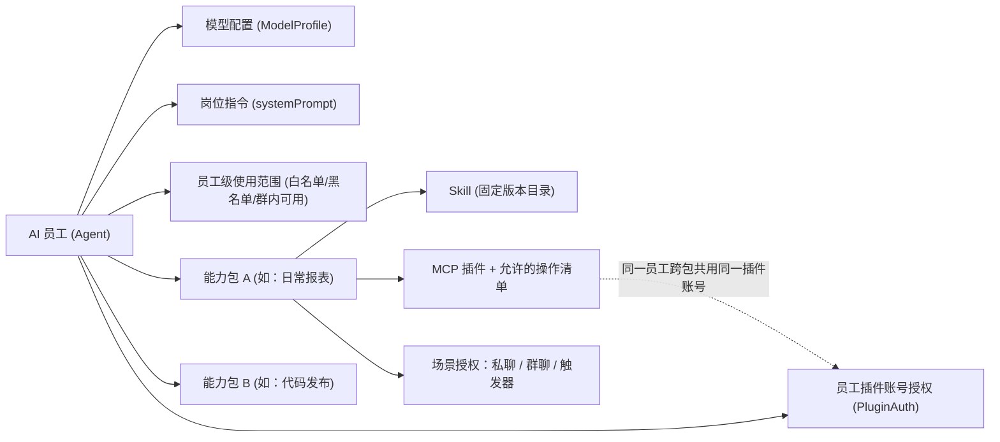

# AI 员工、能力包、Skill 与 MCP 插件指南

本指南介绍如何在 KIKO 企业级AI员工云平台中配置 AI 员工的模型、岗位指令、能力包（Skill 与 MCP 插件）、分场景使用范围，以及如何将验证成熟的员工发布为模板。

## 1. 核心对象关系

在 KIKO 中，员工不会直接零散地绑定某个工具，而是通过**能力包（`CapabilityPackage`）**来组织能力与权限：

- **版本固定与显式升级**：
  - **模型配置（`ModelProfile`）**更新后，所有引用它的新会话自动使用新配置；
  - **Skill 与 MCP 插件**在加入能力包时会**锁定当时的版本号**。当资源库发布新版本时，已绑定的能力包只会提示有新版，需由搭建者显式点击升级并保存，确保生产岗位行为不会因上游静默改动而突变。
- **跨包共用账号、独立限定工具**：同一位 AI 员工的多个能力包如果使用了同一个 MCP 插件（如 GitHub），它们共用该员工名下的一份插件账号授权（`PluginAuth`），但每个能力包可以独立勾选允许调用的工具子集（例如 A 包只允许只读查询 PR，B 包允许在特定发布群创建 Issue）。

## 2. 配置模型（ModelProfile）

在「**资源库 → 模型**」中管理工作区可用的大模型：

| 协议选项 | 适用服务商示例 | 说明 |
| --- | --- | --- |
| `Chat Completions` | DeepSeek、OpenAI、通义千问、智谱、vLLM / Ollama 兼容端点 | 标准 `/v1/chat/completions` 接口 |
| `Responses` | OpenAI Responses API 兼容服务 | 支持原生 Responses 协议 |
| `Anthropic Messages` | Anthropic Claude 系列及兼容网关 | 标准 `/v1/messages` 接口 |

- **对话模式与任务模式的模型行为**：新建主对话（`chat`）与后台任务（`task`）均使用该 AI 员工所选定的模型配置；其中 `chat` 模式固定关闭深度思考以保证即时响应速度，`task` 模式的思考强度与生成参数跟随运行时 Harness。
- **官方模型与积分（可选）**：系统内置 `modelproxy` 模块，支持由平台提供预置官方模型并为每位员工自动签发内部代理 Key，按绑定账户扣减积分（新用户默认赠送 1000 积分）。自托管环境直接配置自有 API Key 的工作区模型即可。

## 3. 管理 Skill（工作方法包）

Skill 是一个包含 `SKILL.md` 的完整目录，用于封装某类专业任务的处理步骤、输入输出标准、脚本（Python/Bash 等）、模板或参考资料。

### 3.1 导入与更新 Skill

在「**资源库 → 技能（Skill）**」中支持四种方式创建或更新版本：

1. **ZIP 压缩包上传**：上传包含顶层 `SKILL.md` 及配套 `scripts/`、`templates/`、`references/` 的归档包（保留完整目录结构与附件）。
2. **公开 GitHub 仓库导入**：填入 GitHub 仓库或子目录链接，系统自动拉取快照并校验。
3. **Markdown 文件导入**：适合仅包含单文件 `SKILL.md` 指令的轻量技能。
4. **手动在线编辑**：在页面上直接编写或更新正文。

每次发布都会生成不可变的独立版本目录。现行本地部署默认保存在宿主机 `~/.kiko`（容器内 `/mnt/kikoteam`），也可通过 `KIKO_STORAGE_S3_*` 选择 S3 兼容资产后端。任务执行通过共享本地磁盘读取 Skill，容器根和官方、工作区 Skill 的位置见[存储目录设计](../architecture/storage-paths.md)。

### 3.2 内置官方 Skill 一览

系统开箱提供 12 个官方 Skill。

| 标识 | 名称 | 典型用途 |
| --- | --- | --- |
| `status-report` | 项目周报与风险汇总 | 按进展、风险、阻塞项和下周计划生成结构化周报 |
| `minimax-xlsx` | Excel 合并与公式校验 | 多表合并、字段对齐、公式检查与报表生成 |
| `reconciliation` | 账表对账 | 核对两份流水或台账差异，输出差异明细与汇总表 |
| `synthesize-research` | 用户反馈归纳 | 从访谈、工单或评论中提炼高频痛点与需求聚类 |
| `kb-article` | 客服 FAQ 整理 | 将零散问答或排障记录整理为标准知识库文章 |
| `competitive-brief` | 竞品与行业简报 | 对比产品定位、功能变化与市场动态 |
| `draft-content` | 多渠道内容初稿 | 根据素材撰写公众号、社区或内部通告初稿 |
| `pptx-generator` | 汇报 PPT 制作 | 生成结构化演示文稿文件 |
| `code-review` | GitHub PR 评审 | 结合代码变更检查边界条件、潜在缺陷与规范符合度 |
| `tavily-search` | Tavily 资讯检索与核实 | 多源检索公开资讯并交叉核实出处 |
| `market-close` | A 股收盘简报 | 结合指数与个股行情数据生成每日复盘简报 |
| `video-editing` | 视频剪辑与素材合成 | 剪切和拼接已有素材，配上音轨并交付 MP4 |

从新版「内容运营编辑」模板创建员工时，基础交付包已包含视频 Skill。已有员工可在能力包里添加「视频剪辑与素材合成」。在 Web 私聊中上传视频、图片和配乐（每个文件最多 32 MiB），例如发送“取视频第 1 至 3 秒，结尾显示封面 1 秒，用配乐替换原声”。任务完成后在任务产物中下载 MP4。

## 4. 管理 MCP 插件与账号授权

在「**资源库 → 插件**」中可以管理远程 HTTP / HTTPS MCP 服务，并在 AI 员工的能力包中按需挂载。

### 4.1 支持的认证方式

| 认证类型 | 配置方式 |
| --- | --- |
| **免认证（`none`）** | 无需绑定凭据，添加到员工能力包后即可在授权范围内调用 |
| **API Key / Bearer（`api_key` / `bearer`）** | 支持配置为**工作区共享连接**或**员工专属账号**；凭据加密存储，运行时由 Backend 代为鉴权或注入 |
| **OAuth 2.0（`oauth`）** | 在员工详情页点击授权，通过浏览器完成第三方 OAuth 登录与 Token 自动续期 |

> [!NOTE]
> - **GitHub 官方插件 OAuth 配置**：GitHub 插件同时支持个人访问令牌（PAT）和 OAuth。若使用 OAuth，请在你的 GitHub App 中将回调地址注册为 `<KIKO_PUBLIC_ORIGIN>/api/v1/auth/callbacks/plugin-oauth`，并在「设置 → 平台管理 → 插件集成」中保存并启用该 App 的 Client ID 和 Client Secret。
> - **私网 MCP 访问安全**：默认禁止远程 MCP 访问环回地址（Loopback）、链路本地地址及未授权内网网段以防范 SSRF。如果自托管环境需要连接内网自建的 HTTP MCP 服务，必须由管理员在 `.env` 中显式配置 `KIKO_MCP_PRIVATE_CIDRS`（例如 `10.10.0.0/16`）。

### 4.2 内置官方 MCP 插件一览

| 标识 | 名称 | 认证方式 | 默认能力简述 |
| --- | --- | --- | --- |
| `stock` | A 股行情快查 | `none` | 查询三大指数与个股实时行情快照 |
| `exa` | Exa 公开资料检索 | `none` | 语义化公开网页与技术资料检索 |
| `github` | GitHub | `bearer` / `oauth` | 仓库、Issue、Pull Request 与代码只读查询 |
| `tavily` | Tavily 联网搜索 | `bearer` | 面向 Agent 的实时网页搜索与正文提取 |
| `zhipu` | 智谱联网搜索 | `bearer` | 中文互联网实时资讯搜索 |
| `hithink` | 同花顺 A 股行情 | `api_key` | 深度 A 股行情与财务数据查询 |
| `feishu` | 飞书云文档 | `api_key` | 读取与检索获授权的飞书云文档内容 |
| `tencent_meeting` | 腾讯会议纪要 | `api_key` | 查询会议录制转写与智能纪要 |
| `dingtalk` | 钉钉待办 | `api_key` | 查询与管理钉钉待办事项 |
| `fxiaoke` | 纷享销客 CRM | `oauth` | 客户、商机与跟进记录查询 |
| `amap` | 高德地图 | `api_key` | 地理编码、POI 搜索与路径规划 |

## 5. 配置使用范围（两层权限模型）

为了在企业群聊中安全地使用 AI 员工，KIKO 采用「**员工准入 → 能力包场景授权**」两层校验，且**下游能力包永远不能突破上游员工的准入边界**：

1. **第一层：谁可以使用这位 AI 员工？（员工「使用范围」页签）**
   - **人员范围**：支持「全员可用 + 黑名单」或「仅白名单」。可直接选择工作区账号、飞书/钉钉人员或部门（含子部门）、已核验的企微联系人。
   - **群内可用开关**（默认开启）：开启后，只要 AI 员工被拉入该群，群内非黑名单成员均可 @ 它协作；关闭后，群内也必须命中员工白名单的人员才能调用。
2. **第二层：在不同场景下能调用哪些工具？（能力包场景配置）**
   - 每个能力包对**私聊**、**群聊**、**触发器（定时/Webhook）**三个场景独立设置启停与适用人群/群组/具体触发器规则。
   - **典型配置示例**：某位研发 AI 员工在所有研发群都可对话，但将其绑定的「生产发布能力包」设为**仅在群聊开启，且必须同时满足「所在群 = 生产发布群」与「调用人 = 值班负责人」**，在私聊和其他群中完全禁用该能力包。

## 6. AI 员工市场与模板发布

在「**AI 员工市场**」中，你可以：

- **从模板创建员工**：创建向导分三步（「岗位设定 → 模型与接入 → 确认创建」），模板预设的岗位指令、能力包、固定版本 Skill 和插件操作清单会整体复制给新员工，无需重新勾选。
- **把现有员工另存为模板**：在员工详情页点击「**另存为模板**」，将团队名、项目标识等提炼为创建参数。
  - **工作区模板**：工作区 Owner / Admin 可发布到本工作区，供团队成员复用；
  - **官方精选模板**：平台管理员（首个登录用户或获授权账号）可发布至全局官方精选。
  - 模板发布时会冻结所引用的 Skill 与插件版本，且不会带出原员工的任何密钥、业务账号凭据、群聊绑定或历史任务记录。
