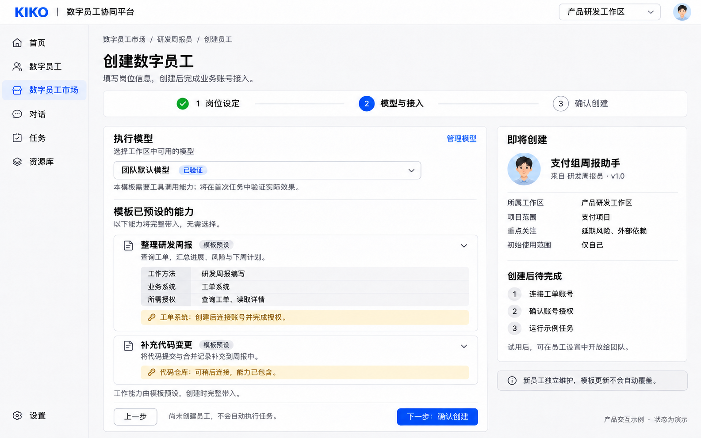

# AI 员工市场与员工模板设计

状态：2026-11-18，AI 员工市场首版已实现。工作能力由模板作者完整预设，从模板创建员工时无需再次选择；接口与数据设计见[API、数据库与关键流程](../../backend/docs/agent-template-market.md)。

API、数据库与关键实现流程见[技术设计](../../backend/docs/agent-template-market.md)。

AI 员工市场让团队按工作目标选择 AI 员工模板，查看交付样例，再用自己的模型、账号和业务范围创建独立员工。模板已经配好工作能力，用户填写岗位信息、选择模型并完成必要接入即可使用。首版覆盖官方精选与工作区模板，以完成第一项真实任务为闭环。

## 1. 命名与产品边界

| 位置或对象 | 统一名称或文案 |
| --- | --- |
| 一级导航与页面标题 | AI 员工市场 |
| 对外完整名称 | KIKO AI 员工市场 |
| 页面引导语 | 为团队找到下一位好帮手 |
| 页面说明 | 从成熟的岗位模板开始，让 AI 员工接手具体工作。 |
| 搜索提示 | 想把什么工作交给 AI 员工？ |
| 市场中的内容 | AI 员工模板，页面内简称模板 |
| 主操作 | 用此模板创建 |
| 员工详情中的制作入口 | 另存为模板 |
| 创建结果 | 工作区内的一位 AI 员工 |

「AI 员工市场」负责发现、比较和复用岗位；「AI 员工」负责管理已经创建的员工及其日常工作；「资源库」继续管理模型、技能、插件及能力包模板。模板作者预设完整的工作能力、能力包、技能、插件及所需操作；创建者整体复用，不在创建向导中重新组合或勾选。员工仍通过能力包获得技能与插件操作，不增加直接绑定入口。

首版提供「官方精选」「工作区模板」两个页签。工作区模板仅在所属工作区分发；官方模板由平台维护者发布。社区投稿、团队间公开分发、付费购买、评分和自动合并模板升级不进入首版。

## 2. 市场列表与模板详情

### 列表

侧栏在「AI 员工」之后增加「AI 员工市场」。「AI 员工 → 新建」提供「从模板创建」「从空白创建」；前者进入同一市场，不维护另一套模板列表。

列表支持按模板名称、职责和交付物搜索，以及按研发协作、运营营销、销售服务、业务分析、通用办公筛选。排序首版提供「推荐排序」「最近更新」；推荐排序由发布者维护，不展示缺少依据的使用量或评分。搜索、分类和页签变化后回到第一页，返回列表保留此前条件和位置。

每张卡片展示头像、岗位名、发布者、职责短句、分类、主要交付物和接入要求。卡片点击或「查看详情」打开右侧详情面板；窄屏切换为独立详情页。页头「管理模板」只向有模板管理权的用户展示。

接入提示表达模板要求，例如「无需连接业务系统」「需连接工单系统」，不把工作区中存在同类插件当成新员工已获授权。无需业务系统的模板也需要可用模型。

### 详情

详情按用户做决定的顺序展示：

| 区域 | 内容与操作 |
| --- | --- |
| 岗位介绍 | 名称、发布者、版本、更新时间、适用对象、负责及不负责的工作 |
| 试着交给它 | 至少一条可直接委派的示例任务；含必填业务参数时显示填写提示 |
| 交付示例 | 与示例任务配对的脱敏或虚构样例，标注「示例内容」，说明完成标准 |
| 能完成哪些工作 | 只读展示模板已经预设的全部工作能力、输入与产出，标明可独立使用的部分 |
| 创建前需要 | 模型能力要求、固定资源依赖、必需及可稍后完成的业务接入 |
| 模板内容 | 可展开查看岗位指令、参数、能力包及资源固定版本 |
| 维护信息 | 发布版本、变更说明、维护者和发布时间 |
| 固定操作栏 | 「用此模板创建」；提示「创建后独立维护，模板更新不会自动覆盖」 |

“官方”表示发布来源。首版不展示「示例已验证」徽章，不建立验证证据关联流程；用户通过创建后的真实试用判断是否适合自己的工作区。静态交付样例始终标为「示例内容」。

无创建权限的成员仍可浏览获准模板，操作区显示「创建员工需要工作区管理权限」。首版不增加申请审批系统或自动发送通知。

## 3. 一份模板包含什么

### 内容规格

| 内容组 | 必需内容 | 创建时如何使用 |
| --- | --- | --- |
| 展示信息 | 名称、头像、职责短句、分类、适用对象、维护者 | 名称与头像提供初始值，员工可改名 |
| 岗位设定 | 职责、工作方法、交付标准、边界、缺信息时如何追问 | 填入员工岗位指令，可预览后修改 |
| 岗位参数 | 字段名、说明、类型、是否必填、合理默认值或示例 | 生成岗位设置表单，填入指令与示例任务 |
| 能力组合 | 完整工作能力、能力包内容快照、包内技能与插件的固定版本及预设操作清单 | 整体复制为新员工的独立能力包，资源在工作区内按固定版本引用；创建者无需勾选 |
| 接入要求 | 模型所需能力、业务系统、接入参数、账号与操作要求 | 生成创建前说明和创建后的接入清单 |
| 示例任务 | 至少一条代表性任务、所需输入、依赖的能力 | 作为首次试用的可编辑输入 |
| 交付样例 | 对应任务的样例结果、成功标准、来源说明 | 帮助用户判断结果是否符合岗位预期 |
| 发布信息 | 版本、变更说明、发布时间、来源 | 记录员工的创建来源，支持追溯 |

岗位参数首版采用短文本、长文本、单选和多选，不引入条件表单或流程脚本。模板可没有自定义参数。一般使用三至五项，把每次任务都会变化的日期、材料、问题留在对话中；账号凭据不作为岗位参数。

参数只有明确声明的占位符才会替换，未填写必填值时不能提交创建。字符串作为普通文本插入岗位指令和示例，不执行表达式、命令或模板脚本。修改参数后同步更新预览；修改岗位指令后保留用户文本，并在再次替换可能覆盖修改时让用户选择。

模板同时预设工作能力和所需操作，创建及接入流程只读展示，不要求用户再选技能、插件或工具。账号接入时根据预设操作说明所需权限，用户确认授权，系统核对实际可用性；模板不能携带业务账号授权或绕过成员、账号和资源权限。

「必需接入」「可稍后接入」描述业务系统的就绪要求。所有预设能力都会随模板复制；某个账号暂未连接时，对应能力保留为待接入，不从员工配置中删除。例如研发周报员同时预设工单汇总与代码变更汇总，代码仓库可稍后连接，接入前周报只覆盖工单。必需接入缺失时，只有作者明确声明并给出独立示例的替代方式可以继续使用。

### 复制与归属

| 随模板复用 | 在新员工中重新确定 | 留在原员工或工作区 |
| --- | --- | --- |
| 岗位设定、参数定义、完整能力包组合、资源版本、预设操作清单、示例任务、脱敏交付样例 | 员工名称、参数值、具体模型、插件账号及环境、对应账号授权、成员使用范围 | 密钥、登录态、账号授权记录、成员名单、群与渠道绑定、真实历史任务、记忆及业务文件 |

已有员工「另存为模板」时，只提取岗位与能力配置。历史对话、业务文件和真实交付物不自动加入样例；作者另行提供可发布的样例。项目名等业务信息可改为岗位参数；私有地址、固定成员及秘密信息需清理，不通过岗位参数替换插件服务器地址或认证头。

同工作区创建员工时复用获准资源的固定版本，完整复制能力包配置，不给每位员工再复制一份 Skill 权威资产。官方模板发布时固定获准分发的不可变资源版本并保留其资产，创建时再准备到目标工作区；不向使用者暴露来源工作区的私有引用。发布后的官方内容通过模板下架停止分发，源工作区普通启停不改写官方发布版本；目标导入资源仍受本工作区的启停与账号权限控制。这是创建用例内部步骤，没有单独的用户操作或前端准备接口。准备失败时不能静默删减预设能力后创建员工；业务账号可在员工创建后补齐。

模板发布版本固定能力包内容，不要求为现有能力包新增一套独立发布生命周期。新员工保留来源模板及版本；模板后来改名、更新或下架，不覆盖员工的职责、模型、能力包或使用范围。创建后有定制需求时，管理者可进入员工设置调整能力，不把配置工作前置给每位模板使用者。

## 4. 模板制作与发布

入口为「AI 员工市场 → 管理模板 → 新建模板」，或「AI 员工 → 员工详情 → 另存为模板」。编辑器按「岗位介绍、岗位设定、能力与接入、示例与交付、发布预览」组织，支持保存草稿。工作能力、能力包组合和操作清单在这里由模板作者配置完整，发布后供创建者直接复用。

版本号由系统自动累计：首次保存为 v1，以后每次保存有变化的内容生成 v2、v3；内容相同不生成空版本。作者只需要「保存」和「发布」，不用填写版本号、选择升级类型或走审核流程。最新保存版本未发布时就是草稿，发布不再另外生成版本。

管理界面区分「最新保存版本」与「当前发布版本」。例如 v1 已发布，修改并保存 v2 后，编辑器显示「v2 草稿」，管理列表显示「已发布 v1 · 有未发布修改」；市场的名称、详情、能力及状态仍全部取 v1。点击发布 v2 后，市场才切换为 v2。连续保存 v2、v3 后直接发布 v3 也可以，v2 仅保留在管理者的保存历史中。

发布前需要完成以下检查：

1. 展示信息、岗位指令、必填参数说明、示例任务和交付样例完整，样例与任务相匹配。
2. 能力包及资源版本明确，依赖可用且允许向目标范围分发；模板所需运行方式受当前平台支持。
3. 必需与可稍后完成的接入项明确；无接入条件下可完成的工作有独立说明，不能用模型自行生成内容冒充已查询业务系统。
4. 作者检查岗位指令、参数默认值、资源内容和样例中的私有信息；发布界面展示最终将公开给工作区或平台用户的内容。

作者可以通过现有员工和任务自行试用后发布；首版不要求关联验证任务，不保存验证证据或认证状态。岗位完整性、固定资源和分发权限仍由发布用例校验。

| 状态或动作 | 用户可观察的行为 |
| --- | --- |
| 从未发布的模板 | 最新保存版本为草稿，仅管理者可见；可继续编辑或删除，市场不展示 |
| 首次发布 | 将最新保存版本设为市场可见版本，进入相应页签；不增加版本号 |
| 编辑已发布模板并保存 | 自动累计下一版本，最新版本为草稿；市场继续展示原版本及其已发布状态 |
| 发布新版 | 市场切换到最新保存版本；正在创建的人保留已选择的已发布版本，只要该版本仍可分发 |
| 下架 | 市场不再推荐，也不再允许新建员工；详情链接显示下架状态 |
| 下架后编辑保存 | 仍为下架，不因出现新草稿而恢复展示 |
| 重新上架 | 重新检查资源与发布条件，上架原已发布版本；不顺带发布草稿 |

未保存修改先保存再发布；下架模板发布新草稿时按钮明确为「发布并上架」。发布失败时草稿保留，原市场版本和状态不变。发布过程中若其他管理者保存了新版本，提示重新核对，不悄悄发布未看过的内容。

已发布模板首版用下架管理，不提供彻底删除已被引用版本的入口。下架不删除既有员工或其依赖；资源停用、账号撤权仍按现有规则影响后续执行。

官方模板只有平台管理员可以新建、编辑、查看草稿、发布和下架；工作区模板及员工仍由本工作区 owner/admin 管理，member 浏览获准模板。角色与发布来源分别展示。模板详情可见不意味着能创建员工，能编辑员工也不自动获得其他账号或数据的访问权。

平台首位成功登录的用户自动成为平台管理员，注册后自动登录也计入；初始化只发生一次。平台管理员通过「设置 → 平台管理 → 用户管理」给其他已注册账号授予或撤销平台管理员资格，至少保留一名管理员。平台管理员权限与工作区管理员权限独立，具体账号、接口及并发规则见[平台管理员设计](../../backend/docs/platform-auth.md#平台管理员)。

## 5. 从模板创建员工

整体路径：AI 员工市场 → 模板详情 → 三步创建向导 → 员工接入清单 → 首次试用 → 开放给团队。

创建向导使用独立内容页，保留工作区与返回入口。上方展示三步进度，左侧主表单，右侧固定模板摘要。返回上一步保留已填内容；离开存在未保存内容的向导时使用现有草稿离开确认。首版不新增服务端员工草稿或跨设备恢复功能。

### 第一步：岗位设定

标题「设置这位员工的岗位」。显示模板名称与版本，填写员工名称、头像和模板声明的岗位参数。职责简介继承模板并可编辑；「查看岗位指令」展开完整内容及替换后的预览，允许修改。

预览在前端根据模板详情即时生成，例如把 `{{project_scope}}` 替换成「支付项目」；接入说明直接取模板预设。它不调用模型或业务系统，不另设预览 API；最终创建时由后端重新校验参数并生成岗位指令。用户主动编辑的完整指令单独提交，不能被后续参数刷新悄悄覆盖。

以研发周报员为例：员工名称「支付组周报助手」，项目范围「支付项目」，重点关注「延期风险、外部依赖」，报告结构「本周进展／风险与阻塞／下周计划」。时间范围留在每次任务中填写。

名称或必填参数缺失时在字段旁说明，点击「下一步」定位首个错误。字段的格式要求在输入前展示，不在下一页突然增加要求。同名员工需要清楚区分，可建议追加项目名，不擅自规定名称唯一。

### 第二步：模型与接入

标题「选择模型，了解接入要求」。模型预选当前可用的工作区默认项，明确显示实际选择；无默认项时让用户选择。没有已启用且已验证的模型时不能创建，展示「先配置一个可用模型」及有权限的配置入口。同页打开配置面板时保留向导内容；返回后刷新模型可用性，不静默换绑。

模型要求和已有测试结果分别显示，例如「需要工具调用能力」「尚未验证该能力」。已知不满足模板硬性要求的模型不能使用；缺少验证证据不能标成满足，保留待试用说明。模型名称本身不作为能力验证依据。

「模板已预设的能力」以只读列表展示，例如「整理研发周报」「补充代码变更」，均标注「模板预设」。列表没有勾选框、开关或添加、移除入口，也不以灰色禁用控件暗示用户需要选择。可以展开了解用途与依赖，技术内容收在详情中。预设能力随模板整体复制；此步的主要操作是选择模型并了解接入要求。

能力完整复制与运行授权分别处理：缺少某个账号时保留全部预设配置，未授权操作不可执行，其他已授权资源沿用现有运行规则。接入清单说明尚缺哪些条件，示例任务仅在其声明的依赖满足时提供试用入口；首版不增加整包统一启用或禁用的运行策略。

这一页完成资源可用性预检，展示「工单系统：创建后需连接」「代码仓库：可稍后连接」等接入要求；不展示其他员工的凭据，也不把其他员工的账号自动带入。需要认证后才能确认的操作保留为待核对项，不先写成已授权。模板内固定资源版本不可用或平台尚不支持其运行方式时阻止创建，并说明受影响工作；缺少业务账号允许在创建后补齐。

### 第三步：确认创建

标题「确认创建这位员工」。摘要展示目标工作区、员工名称、岗位参数、具体模型、模板预设能力、待连接系统及来源模板版本。

初始使用范围为「全员可用＋空黑名单」。能力包初始范围随员工范围，并保留包内更窄的操作限制。页面说明创建后可在员工设置调整使用范围。渠道接入与定时任务仍通过各自设置开启。

主按钮「创建员工」，次按钮「上一步」。提交前重新核验创建权、模型、模板版本及模板内固定资源。用户确认的版本不因市场发布新版而被替换；已下架或不可再分发时留在当前页，说明原因并提供返回模板入口。

一次创建应得到一位员工及完整的岗位和能力配置。需要账号授权的部分保留接入需求，不提前产生工具使用权。成功后直接进入这位员工的概览。创建不自动开始任务或调用业务系统。

### 创建后的接入清单

概览顶部显示「员工已创建」，同时列出待完成事项。有可执行示例时主按钮为「试用示例任务」；缺少该示例的必需接入时主按钮为「完成接入」，并标明例如「还需连接工单系统」。用户可以离开，稍后从 AI 员工列表的「继续配置」回到同一员工。

每个业务系统一张接入卡：说明用途、必需或可稍后接入、目标环境、模板预设的操作要求、当前状态及处理按钮。用户在具体员工名下连接账号并确认所需授权，系统验证实际可用操作是否满足预设要求，不再要求逐项勾选工具。仅允许模板预设且当前账号及使用范围均获准的操作；认证成功但缺少某项操作时仍显示受影响能力待配置。

同一员工的多个能力包使用同一插件时只配置一次账号，各包的操作范围独立。不同员工不会因使用同一模板自动共享账号。账号连接失败时保留已创建员工；更换账号时提示受影响的能力包。

首版只呈现平台当时已交付的接入方式。渠道、定时任务和额外协作配置放在员工后续设置中，不挤入这条创建主流程。

### 首次试用与团队使用

点击「试用示例任务」进入该员工的固定私聊，将已代入岗位参数的任务放入输入框，用户可修改并主动发送。按钮不直接执行静态交付样例，也不另建临时演示员工。

试用使用真实模型、当前能力与账号，可能消耗模型额度；涉及业务写入的示例在发送前说明目标系统和操作。沿用已有任务进度、补充输入和停止入口，不另外增加通用审批流程。配置变化后重新试用按新任务使用当时配置，旧任务历史保留原配置。

任务完成后展示真实结果，提供「继续使用」「调整岗位」「开放给团队」；调整时回到对应设置并保留本次任务。首版不增加「符合预期」评价按钮、满意度记录或验证徽章，任务结果继续使用已有记录；任务完成不代表用户已经认可交付质量。

「开放给团队」进入使用范围设置，由管理员选择工作区成员或指定成员并保存。试用是建议步骤，管理员也可以稍后试用并明确调整范围；不额外增加员工发布状态。任何授权变化继续受当前成员、能力包和账号权限共同约束。

### 从空白创建

从空白创建沿用现有员工新建入口与接口，本次市场功能不重做另一套向导。用户按现有表单填写名称和模型，创建后在员工设置补齐岗位及能力包；没有模板来源或模板试用状态。能力配置保留在自行搭建和员工后续设置中，不混入从模板创建流程。

## 6. 状态与异常交互

员工启停、创建是否成功、能力就绪、示例任务是否完成分别表达。「待配置」「部分能力可用」「可试用」是根据当前模型、资源、账号与授权得出的概览，不新增与员工启停竞争的发布生命周期。

| 场景 | 页面行为与后续操作 |
| --- | --- |
| 市场加载失败 | 显示错误与重试，不显示成「暂无模板」 |
| 搜索无结果 | 展示当前搜索条件，提供清除筛选；有权限时可从空白创建 |
| 工作区暂无模板 | 提示「将成熟的员工配置另存为模板，供团队复用」；管理员可新建，成员可浏览官方精选 |
| 模板无权查看或已下架 | 直接访问详情也核验权限；不可见时不泄露模板内容，下架时不再提供创建按钮 |
| 创建过程中切换工作区 | 有未保存内容时确认离开；不携带旧工作区的模型、账号或成员选择，不接受旧请求的迟到结果 |
| 模板内固定资源不可用 | 解释缺少哪个资源、影响哪项工作；不删减预设能力或以其他版本悄悄替代 |
| 无可用模型或所选模型失效 | 保留填写内容，要求选择或配置可用模型；不自动切换到另一模型 |
| 重复点击创建 | 提交中禁用重复按钮，不自动重发创建请求；用户主动再次提交按新建员工处理 |
| 创建请求结果未知 | 保留表单，提示先查看员工列表及详情核对；不直接报告失败，不自动重试，也不承诺再次提交仍是同一员工 |
| 创建成功但随后页面刷新失败 | 显示「员工已创建，页面加载失败」，提供打开该员工或重新加载；不报告创建失败 |
| 连接失败或授权不足 | 员工保留，卡片显示原因和「重新连接／调整权限」；不丢掉其他已完成的配置 |
| 可稍后接入的系统尚未连接 | 对应预设能力保留为待接入，说明缺少哪些覆盖；仅运行不依赖该接入的任务 |
| 必需接入未完成 | 阻止依赖该能力的示例；存在独立可用能力时允许单独试用，不伪造完整结果 |
| 试用失败或结果不满意 | 保留员工和任务，分别引导检查配置、补充输入或调整岗位；不重新创建员工 |
| 模板后来更新或下架 | 员工继续独立维护；来源页说明变化，首版可用新版另建员工，不自动覆盖原配置 |

创建前检查的接入状态必须有明确依据，不能用缓存或“存在一个连接”推断新员工已可用。真实环境中的未验证状态显示「待检查」，只有示意图可以使用明确标注的演示状态。

## 7. 首批岗位与完整示例

| 模板 | 职责介绍 | 初始输入与接入 |
| --- | --- | --- |
| 研发周报员 | 汇总项目进展、风险与下周计划，每项结论附来源。 | 已预设工单汇总与代码变更汇总；填写项目范围、报告结构，工单系统必需接入，代码仓库可稍后接入 |
| 会议纪要助手 | 从会议文字中整理决策、待办、负责人和截止时间。 | 粘贴会议文字，无需连接业务系统 |
| 客户跟进助手 | 整理客户沟通记录，起草下一步跟进建议与邮件。 | 粘贴沟通记录，仅生成草稿，首版不承诺发送邮件或写入 CRM |
| 数据解读助手 | 解读业务数据，标出变化、异常与待核实问题。 | 粘贴结构化数据和指标口径，不依赖尚未交付的文件上传 |
| 文案编辑 | 按品牌语气打磨内容，给出可选标题与修改理由。 | 原稿、受众与品牌语气，无需连接业务系统 |
| 需求整理助手 | 把零散反馈整理成需求条目、验收标准和待确认项。 | 粘贴反馈与产品背景，无需连接业务系统 |

研发周报员的首个完整闭环：

1. 在 AI 员工市场选择官方模板，查看一份标注为示例的支付项目周报，了解模板已预设工单汇总与代码变更汇总。
2. 命名为「支付组周报助手」，填写项目范围及报告结构，选择一个可用工作区模型；全部工作能力随模板带入，无需再次选择。
3. 在确认页看到「全员可用＋空黑名单」「创建后需连接工单系统」，点击「创建员工」。
4. 在员工概览连接支付项目账号，确认模板预设的查询工单和读取详情授权，系统验证对应操作；代码仓库暂不连接，代码变更汇总保留为待接入。
5. 打开试用输入「整理本周支付项目进展，标出延期风险和下周计划，每项结论附工单链接」，检查日期范围后发送。
6. 任务返回实际周报，明确因代码仓库尚未连接，当前只覆盖工单。用户检查来源与结论后，可进入「开放给团队」把员工开放给支付组成员。日后连接代码仓库即可使用预设的代码变更汇总，无需重新添加能力。
7. 后续另存为工作区模板时，把「支付项目」重新提取为参数，提供脱敏样例；其他团队创建自己的员工并独立连接账号。

### 创建页面示意

示意图展示三步创建向导的第二步「模型与接入」，工作能力以模板预设的只读内容呈现；账号接入在创建后的员工概览完成。模型和接入状态均为设计示例。

示意图制作于改名前，页面名称以当前版本为准。

图片使用内置 imagegen 修订，[完整提示词](assets/digital-employee-market-create-employee.prompt.txt)随图保存，后续可按同一视觉规范继续补图。

## 8. 交付边界与验收

本期实现覆盖市场列表与详情、模板编辑和发布、按固定版本创建员工、账号接入衔接、首次试用与工作区内复用。接口、数据结构和资源分发机制由[技术设计](../../backend/docs/agent-template-market.md)细化；作者通过工作区能力包模板或从员工另存为模板带入固定资源与工具预设，不在创建员工时选择能力。

本轮简化把来源和使用范围并入现有员工详情与编辑接口，接入概览只读计算；不增加准备任务、满意度评价、验证证据或模板专用执行策略。保留三步创建、完整预设能力、默认全员可用、真实试用和显式配置限制。

现有员工无需补来源模板才能继续使用；通过新向导创建的员工记录来源。现有能力包、模型更新规则和固定私聊关系保持各自约定。从模板创建只填写岗位参数、选择模型及了解接入要求，预设能力整体带入并只读展示；实际创建仍要求可用模型，账号未接入允许创建后补配。

后续实施至少验证：

- 无插件模板能完成选择、创建和真实首次任务；有插件模板能在创建后明确定位并补齐接入。
- 从模板创建不出现能力、技能、插件或工具的勾选入口；所有预设能力完整带入，可稍后连接的账号缺失时对应能力仍保留，接入后无需再次添加。
- 同一模板创建两位员工，名称、模型、参数、账号与使用范围互不覆盖；来源更新不改变已有员工。
- 官方模板的依赖可在目标工作区合法使用；其他工作区私有资源不可越权引用，失败不产生缺少模板固定资源的员工。
- 发布新版保留旧版，旧版创建向导不被静默切换；下架阻止新的创建但不删除已有员工。
- 模板无凭据、授权记录、真实群和历史内容；预设操作仍经当前账号授权与使用范围核验，连接账号不绕过能力包，也不额外授予模板外操作。
- 无模型、模板固定资源失效、权限变化、重复提交、创建回执丢失和创建后刷新失败均有明确恢复路径；提交中防重复点击，结果未知不自动重发。用户主动重复创建可生成独立员工；创建成功后的刷新只读取原员工。
- 跨工作区迟到响应被丢弃；成员只读与管理员写入分别验收；初始全员可用，管理员可显式保存限制。
- 必需与可稍后完成的接入影响正确的任务，部分可用不被展示成全部就绪；试用结果来自真实任务，静态样例不充当执行成功。

产品指标可从既有创建、接入和任务事实观察创建完成率、首次任务耗时及中断原因；首版不为满意度指标新增反馈表或评价流程。
